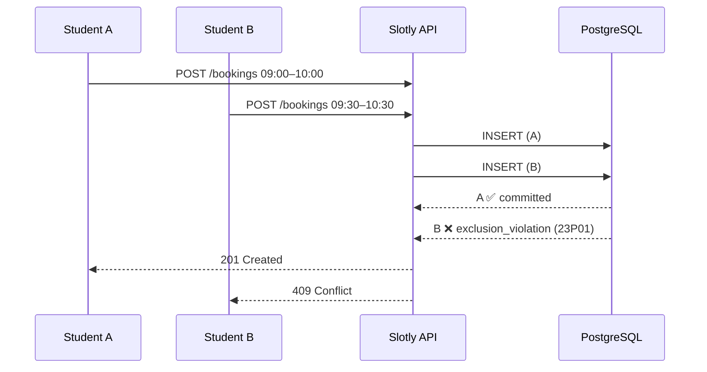
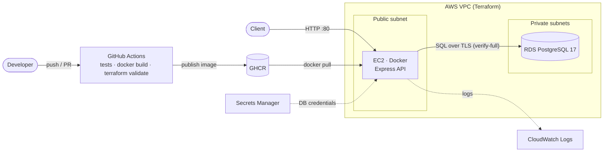

# Slotly

[](https://github.com/EricK-6/slotly/actions/workflows/ci.yml)


**A booking REST API for university lab equipment (FPGA boards, oscilloscopes, Raspberry Pis) where double-booking is impossible, because PostgreSQL itself enforces it.**

## Why it's interesting

Most booking systems check for conflicts in application code: *"is this slot free? → then insert."* That pattern has a race condition. Two students click **Book** at the same moment, both checks see an empty slot, and both inserts succeed. Now two people turn up for one oscilloscope.

Slotly puts the rule in the database, where it is checked atomically for every write, whatever the number of API servers:

```sql
CONSTRAINT bookings_no_overlap EXCLUDE USING gist (
  resource_id WITH =,                              -- same piece of equipment
  tstzrange(starts_at, ends_at, '[)') WITH &&      -- overlapping time range
) WHERE (cancelled_at IS NULL)                     -- cancelled bookings free the slot
```



**It's tested, not just claimed.** The test suite fires 20 simultaneous overlapping requests (10 rounds of them) and asserts exactly one `201` and nineteen `409`s each time. A second test opens two raw database transactions, shows that a naive *"is it free?"* check passes in **both**, and proves Postgres still rejects the second insert. If you delete the constraint, all 20 requests succeed and the tests fail.

**A bug the tests caught along the way:** under heavy concurrency, two exclusion checks can end up waiting on each other. Postgres resolves that by aborting one with `deadlock detected`, which surfaced as a `500` roughly once every few runs. The booking transaction now takes a row lock on the resource first (`SELECT … FOR NO KEY UPDATE`), so requests for the same item queue up and every loser gets a clean `409`. Different resources never wait on each other.

## Architecture



Locally, `docker compose` runs the same image: **db** (Postgres) → **migrate** (one-shot: migrations + seed data) → **api**, each waiting on the previous one's health check.

## Quick start

Requires Docker. No `.env` or other setup needed.

```bash
git clone https://github.com/EricK-6/slotly.git && cd slotly
docker compose up
```

The API is now on `http://localhost:3000`, seeded with lab equipment and three users.

```bash
# What FPGA boards are there?
curl "localhost:3000/resources?category=fpga"

# Ada books FPGA #1 from 09:00 to 11:00
curl -X POST localhost:3000/bookings -H 'content-type: application/json' \
  -d '{"resource_id":1,"user_id":1,"starts_at":"2026-11-02T09:00:00Z","ends_at":"2026-11-02T11:00:00Z"}'
# 201 {"id":1,"resource_id":1,"user_id":1,"starts_at":"2026-11-02T09:00:00.000Z",...}

# Alan tries 10:00-12:00 on the same board
curl -X POST localhost:3000/bookings -H 'content-type: application/json' \
  -d '{"resource_id":1,"user_id":2,"starts_at":"2026-11-02T10:00:00Z","ends_at":"2026-11-02T12:00:00Z"}'
# 409 {"error":{"code":"booking_conflict","message":"Resource is already booked for an overlapping time range"}}

# Back-to-back is fine (ranges are half-open), so Alan takes 11:00-12:00
curl -X POST localhost:3000/bookings -H 'content-type: application/json' \
  -d '{"resource_id":1,"user_id":2,"starts_at":"2026-11-02T11:00:00Z","ends_at":"2026-11-02T12:00:00Z"}'
# 201

# See the board's schedule, then cancel Ada's booking
curl "localhost:3000/bookings?resource_id=1"
curl -X DELETE localhost:3000/bookings/1    # 204
```

## API

| Method | Path | Description | Success | Errors |
|---|---|---|---|---|
| `GET` | `/health` | API and database status | `200` | `503` database down |
| `GET` | `/resources?category=` | List equipment, optionally by category | `200` | |
| `POST` | `/resources` | Add equipment `{name, category, location?, max_booking_minutes?}` | `201` | `400` invalid, `409` name taken |
| `POST` | `/bookings` | Book `{resource_id, user_id, starts_at, ends_at}` | `201` | `400` invalid, `404` unknown resource/user, `409` overlap, `422` longer than allowed |
| `GET` | `/bookings?resource_id=` | Active bookings, soonest first | `200` | `400` invalid id |
| `DELETE` | `/bookings/:id` | Cancel a booking (frees the slot) | `204` | `404` not found / already cancelled |

Timestamps must be ISO 8601 **with a timezone** (`2026-11-02T09:00:00Z` or `…+13:00`), so the API never has to guess one. Every error has the same shape: `{"error": {"code": "...", "message": "..."}}`.

## Running the tests

The tests are integration tests (Jest + supertest) against a real Postgres. Nothing is mocked.

```bash
docker compose up -d db   # just the database
npm ci
npm test                  # creates and migrates a separate slotly_test database
```

| Suite | What it covers |
|---|---|
| [`double-booking.test.js`](tests/double-booking.test.js) | 20-way concurrent stampede (×10 rounds); raw two-transaction race that bypasses the API |
| [`bookings.test.js`](tests/bookings.test.js) | overlaps, back-to-back slots, timezone offsets, max duration, cancellation freeing a slot, validation, 404s |
| [`resources.test.js`](tests/resources.test.js) | create, defaults, validation, duplicate names, category filter |
| [`app.test.js`](tests/app.test.js) | health check, unknown routes, malformed JSON |

## Deploying to AWS

[`infra/`](infra) provisions a VPC, security groups, an RDS Postgres instance and an EC2 host that runs the image CI publishes to GHCR.

```bash
cd infra
cp terraform.tfvars.example terraform.tfvars   # optional overrides
terraform init
terraform apply
terraform output api_url
```

Security choices:

- **No secrets in code or state.** RDS generates the DB password and stores it in Secrets Manager (`manage_master_user_password`). The instance reads it at boot.
- **Private database.** RDS sits in private subnets and only accepts connections from the API's security group.
- **Encrypted, verified connections.** The app connects with `PGSSLMODE=verify-full` against the AWS RDS CA bundle.
- **No SSH.** There's no key pair and no port 22. Shell access goes through SSM Session Manager.
- **Hardening.** IMDSv2 only, encrypted volumes, and least-privilege IAM (one secret, one log group).

> The GHCR package must be public, or the instance needs registry credentials. CI checks `terraform fmt` and `terraform validate` on every push. Run `terraform destroy` when you're done to avoid charges.

## Project layout

```
src/
  app.js              Express app: routes, JSON parsing, error handling
  server.js           HTTP server + graceful shutdown
  db.js               pg connection pool + withTransaction helper
  errors.js           Postgres error codes → HTTP responses (23P01 → 409, ...)
  validate.js         small hand-written validators
  routes/             resources.js, bookings.js
db/
  migrations/         plain .sql files, applied in order
  migrate.js          ~60-line migration runner (advisory lock, one transaction per file)
  seed.sql            FPGA boards, oscilloscopes, Raspberry Pis, users
tests/                integration tests against real Postgres
infra/                Terraform: network.tf, database.tf, compute.tf, variables.tf, outputs.tf
.github/workflows/    CI: tests → docker build + smoke test → terraform validate
```

## Design decisions

- **Hand-written SQL, no ORM.** The interesting parts (exclusion constraints, range types, row locks) are Postgres features an ORM would hide. There are only two runtime dependencies: `express` and `pg`.
- **Soft cancellation.** `DELETE` sets `cancelled_at` instead of removing the row. The exclusion constraint is *partial* (`WHERE cancelled_at IS NULL`), so cancelling frees the slot while keeping history.
- **Half-open ranges `[start, end)`.** A booking ending at 10:00 and another starting at 10:00 don't conflict.
- **The transaction does real work.** It locks the resource row, enforces the per-resource maximum duration and inserts, all or nothing.
- **Migrations as a one-shot container.** The API never races to migrate on startup. The migration runner also takes a Postgres advisory lock, so two runners can't collide.
- **Small, non-root image.** Multi-stage build, production dependencies only, runs as the `node` user with read-only code, npm removed, and a built-in `HEALTHCHECK`.

## Skills demonstrated

- **Express.js:** REST API design, Express 5 async error handling, input validation, consistent error responses, graceful shutdown
- **PostgreSQL:** exclusion constraints with `btree_gist` and `tstzrange`, partial constraints, transactions, row-level locking, advisory locks, deadlock diagnosis
- **SQL:** hand-written schema, migrations and queries, with no ORM
- **Docker:** multi-stage non-root image, health checks, Compose with dependency ordering and a one-shot migration job
- **Terraform:** AWS VPC, subnets, security groups, RDS, EC2, IAM least privilege, Secrets Manager, CloudWatch, tagging
- **GitHub Actions:** Postgres service container, integration tests, Docker smoke test, GHCR publishing, Terraform checks

## License

[MIT](LICENSE)
